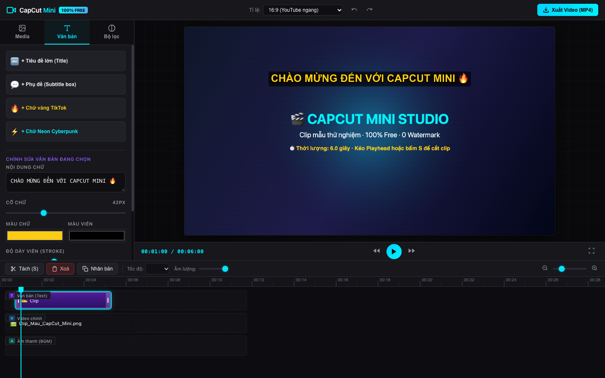

# 🎬 CapCut Mini - Trình Chỉnh Sửa & Cắt Ghép Video Miễn Phí (100% Free)

Một ứng dụng web chỉnh sửa video mạnh mẽ, trực quan với giao diện lấy cảm hứng từ **CapCut**, chạy hoàn toàn phía máy khách (Client-Side), tận dụng GPU máy tính của bạn và **hoàn toàn 0đ chi phí server, không dính logo watermark, không giới hạn độ dài**.



---

## 🚀 Cách khởi động ứng dụng

Bạn có thể mở và dùng ứng dụng bất cứ lúc nào bằng 1 trong các cách sau:

### Cách 1: Chạy file script có sẵn (Nhanh nhất)
Mở Terminal tại thư mục này và chạy:
```bash
./start.sh
```
> Trình duyệt Chrome sẽ tự động được mở tại `http://localhost:8080` và sẵn sàng sử dụng ngay!

### Cách 2: Chạy trực tiếp bằng Python
```bash
/usr/bin/python3 -m http.server 8080
```
Sau đó mở trình duyệt và truy cập: `http://localhost:8080` (hoặc `http://localhost:8080/index.html?demo=true` để nạp ngay clip mẫu).

---

## 🌟 Các tính năng nổi bật (CapCut Style)

### 1. Xem trước thời gian thực (Real-time Preview Player)
- Xem trước mượt mà 60fps qua HTML5 Canvas & Web Audio API.
- Hỗ trợ đổi tỉ lệ khung hình linh hoạt:
  - **16:9**: Video YouTube ngang, màn hình PC.
  - **9:16**: Video dọc TikTok, Instagram Reels, YouTube Shorts.
  - **1:1**: Video vuông Instagram / Facebook.
  - **4:5**: Video bài viết mạng xã hội.
- Phím tắt `Space` để Phát / Tạm dừng, tua tiến / lùi 1 giây, chế độ toàn màn hình.

### 2. Multi-track Timeline chuyên nghiệp
- **Thước đo thời gian & Kim Playhead**: Kéo rê kim chỉ thời gian tới bất kỳ phân đoạn nào.
- ✂️ **Tách clip (Split - Phím S)**: Cắt đôi clip đang chọn tại vị trí kim Playhead.
- ↔️ **Co kéo 2 đầu (Trim)**: Cầm 2 mép đầu/cuối của clip để cắt bỏ đoạn thừa.
- 🗑️ **Xoá (Delete - Phím Backspace/Delete)**: Xoá đoạn clip không mong muốn.
- 📋 **Nhân bản (Duplicate)**: Sao chép clip nhanh chóng.
- ⚡ **Tốc độ (Speed)**: Tăng / giảm tốc độ video từ 0.5x đến 2.0x.
- 🔊 **Âm lượng (Volume)**: Tăng giảm âm lượng hoặc tắt tiếng clip.
- 🔍 **Zoom Timeline**: Phóng to / thu nhỏ dòng thời gian để cắt chính xác từng frame.

### 3. Chèn Văn bản & Phụ đề (Text Overlays)
- Thêm nhanh Tiêu đề lớn (Title), Hộp phụ đề (Subtitle), Chữ vàng TikTok (`#facc15`), Chữ phát sáng Neon Cyberpunk.
- Tuỳ biến: Cỡ chữ, Màu sắc, Màu viền nổi bật (Stroke), Độ dày viền, Màu nền hộp chữ.
- **Kéo thả trực tiếp vị trí chữ ngay trên màn hình xem trước!**

### 4. Bộ lọc màu & Tinh chỉnh video (Color Filters)
- Các bộ lọc phong cách sẵn có: **Điện ảnh (Cinematic)**, **Tươi tắn (Vibrant)**, **Hoài cổ (Vintage)**, **Đen trắng nghệ thuật (B&W)**, **Mơ mộng (Dreamy Blur)**.
- Tinh chỉnh thông số thủ công: Độ sáng (Brightness), Độ tương phản (Contrast), Độ bão hòa màu (Saturation), Đen trắng (Grayscale), Cổ điển (Sepia), Làm mờ (Blur).

### 5. Xuất video MP4 chất lượng cao
- Tuỳ chọn xuất độ phân giải: **1080p (Full HD)** hoặc **720p (HD)**.
- Chuẩn nén H.264 MP4 tương thích 100% với điện thoại, máy tính, mạng xã hội.
- **100% Free**: Không watermark, không thu phí, render trực tiếp trên máy của bạn.

---

## 📁 Cấu trúc mã nguồn

```
app chinh sua video/
├── index.html              # Giao diện chính CapCut Workspace
├── start.sh                # Script khởi chạy 1-click cho macOS
├── css/
│   └── styles.css          # CapCut Dark Theme stylesheet
├── js/
│   ├── app.js              # Khởi tạo và liên kết các thành phần
│   ├── state.js            # Quản lý trạng thái Timeline, Clips, Undo/Redo
│   ├── components/
│   │   ├── player.js       # Bộ điều khiển Preview Player & Tỉ lệ khung hình
│   │   ├── timeline.js     # Thước đo thời gian, Scrubber, Multi-track, Trimming
│   │   ├── toolbar.js      # Thanh nút chức năng: Split, Delete, Duplicate, Speed
│   │   ├── mediaManager.js # Tải video/ảnh/nhạc và tạo clip mẫu dùng thử
│   │   ├── textEditor.js   # Quản lý lớp chữ, kiểu chữ, kéo thả vị trí
│   │   └── filterManager.js# Bộ lọc màu & hiệu ứng video
│   └── engine/
│       ├── renderer.js     # Động cơ composite khung hình Canvas 60fps
│       ├── audioMixer.js   # Động cơ mix âm thanh Web Audio API
│       └── exporter.js     # Động cơ xuất video MP4 không watermark
└── README.md
```
